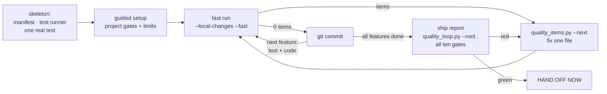
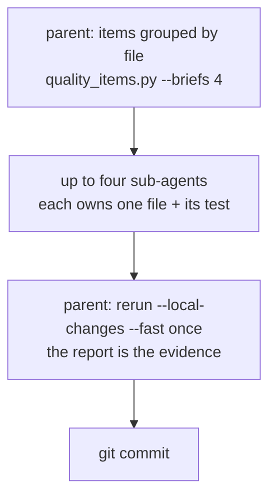

# code-discipline

A self-contained Codex and Claude Code skill for engineering discipline. When
an agent finishes a change, ten generic quality gates judge that change and
send every failure back into its loop, with no project setup for common
languages. First-time [guided setup](skills/code-discipline/references/project-setup-chat.md)
explains gates and limits in chat; saved choices are reused, and disabled gates
stay OFF. The launcher uses Python 3.9+ or downloads a pinned runtime; it
never installs project dependencies.

## The workflow the skill enforces



## The ten gates

| Gate | What it checks in the agent's change | Tools |
|---|---|---|
| No shortcuts | New suppression, skip, or focus markers; silent error handlers; hidden production files; edits to `.quality/` policy | none |
| Secrets | Private keys and known token formats in every touched text file | none |
| File size | A production file that crosses 600 lines, or grows while over | none |
| Project checks | The repository's own lint, type, format, and build commands pass, and none can silently succeed | the repo's own |
| Tests | The suite runs once; no failed, skipped, or filtered tests; the count never drops | the repo's own |
| Coverage | Changed executable lines and branches are covered by that same test run | pinned (coverage.py, c8, cargo-llvm-cov, JaCoCo) or the runtime's own |
| Complexity | Cyclomatic, cognitive, nesting, and CRAP limits for touched functions | pinned lizard |
| Duplication | Copied code touching the change, even with renamed variables | pinned Pygments |
| Dead code | New functions nothing calls, and functions orphaned by removed callers | pinned lizard |
| Vulnerable dependencies | Known OSV advisories for added or upgraded locked packages; manifests without a lockfile | network (OSV) |

Each gate closes a way an agent can hand back a green-looking but risky
result: silencing a check, skipping or deleting tests, leaking a key, leaving
new code unexercised, or copying instead of reusing. Shortcuts and Secrets
match known text patterns; Dead code reports exported, decorated, and method
names for review. C and C++ projects built with CMake or Meson get tests and
gcov coverage with no setup. Coverage needs setup for PHP (pcov or Xdebug)
and .NET (`coverlet.collector`); until then, like any
gate that cannot measure, it reports BLOCKED, never PASS. Policy edits and test
removal need the user's approval: `--allow-policy-change`, `--allow-test-removal`.

The nine rules of [SKILL.md](skills/code-discipline/SKILL.md), one line each:

1. Bootstrap first — guided setup and one real passing test before features.
2. Take no shortcuts; fix the cause and ask the user before policy changes.
3. Build complete connections; prove real writes and read-back.
4. Repair until green from the report; never lower limits to get there.
5. Certify with the full ship report, run in the foreground.
6. Stop only on evidence; report BLOCKED with the exact missing dependency.
7. Disabled gates stay OFF; missing evidence is never a pass.
8. Commit each green step locally; push or rewrite history only when asked.
9. Fan out sub-agents by file, at most four, and measure once (below).

## Fanning out repair work

When a report lists items in many files, the parent delegates disjoint files
and keeps the only measurement:



Sub-agents never run `--init`, edit `.quality/`, or commit; a sub-agent's
"green" is a claim, the parent's single rerun is the evidence.

## Install and set up

Ask: "Install code-discipline here from /path/to/code-skills." The agent installs it and starts setup in the same chat. Its local command is `/path/to/code-skills/skills/code-discipline/scripts/quality --install --root .`. For GitHub installation:

```bash
curl -fsSL -H "Accept: application/vnd.github.raw+json" "https://api.github.com/repos/benrben/code-skills/contents/skills/code-discipline/scripts/install.py?ref=main" | python3 - --repo --root .
```

Globally for all repositories on this computer:

```bash
curl -fsSL -H "Accept: application/vnd.github.raw+json" "https://api.github.com/repos/benrben/code-skills/contents/skills/code-discipline/scripts/install.py?ref=main" | python3 - --global
```

Read the installed guide and finish setup now; restart later for automatic discovery. Codex reads
`.agents/skills/code-discipline`; Claude Code reads its `.claude/skills` link;
global installation creates the same paths under `$HOME`.

## Update

```bash
python3 .agents/skills/code-discipline/scripts/install.py --update-current
python3 "$HOME/.agents/skills/code-discipline/scripts/install.py" --update-current
python3 .agents/skills/code-discipline/scripts/install.py --update-all
```

The first two update this repository and the global copy (`--ref TAG_OR_COMMIT`
pins a version); the third refreshes every recorded copy. Updates preserve
repository configuration, [refresh pinned toolchains and saved HTML](skills/code-discipline/references/quality-loop.md#entrypoint-and-configuration),
and restore each `.claude/skills` link. Every skill change is also published as
`oci://ghcr.io/benrben/code-skills.code-discipline:latest`.

## Run the quality gate

```bash
.agents/skills/code-discipline/scripts/quality --root . --init
.agents/skills/code-discipline/scripts/quality --root . --local-changes --fast
python3 .agents/skills/code-discipline/scripts/quality_items.py --root . --next
.agents/skills/code-discipline/scripts/quality --root .   # ship report
```

Targeted checks never certify: `--shortcuts`, `--secrets`, `--loc`, `--checks`,
`--tests`, `--coverage`, `--complexity`, `--duplication`, `--dead-code`,
`--vulnerabilities`; `--fast` defers only the network-bound vulnerability check.
Every run prints each gate, a `To fix` list, the exact next command, and
`QUALITY_LOOP=` / `ITEMS_TO_FIX=`. Every run writes `.quality/quality-gate-report.html`
and `.quality/quality-gate-state.json`; `--html PATH` moves the HTML. Defaults:
600 lines per file; 90% line and branch coverage of changed lines; cyclomatic 10,
cognitive 15, nesting 4, CRAP 30; clones from 50 tokens and 5 lines; at least one
executed test; zero for every other count. Only a full run prints
`QUALITY_LOOP=PASS`. The [setup guide](skills/code-discipline/references/repository-setup.md)
covers adapters; the [loop reference](skills/code-discipline/references/quality-loop.md) covers reports and repairs.

## Prompt for an agent: install in this repository

```text
Install the complete code-discipline skill in this repository using the
repository install command in README.md. Do not clone the code-skills repo.
Preserve existing work and quality configuration. Read repository-setup.md,
configure this repository's real toolchain, verify both scripts with
--version, then run the fast local-change loop and report the results.
```

## Verify and develop

```bash
python3 .agents/skills/code-discipline/scripts/quality --version   # 5.0.0
python3 -m venv .venv && .venv/bin/python -m pip install -r requirements-dev.txt
.venv/bin/python -m unittest discover -s tests
skills/code-discipline/scripts/quality --root . --no-install
```

The full gate uses `.venv` and `.quality/quality-thresholds.json`. In blind A/B
rounds, v3.5 delivered 3 of 4 green hand-offs where v3.4 delivered 0 of 2;
fan-out also cleared a previously fatal 95-item report.
